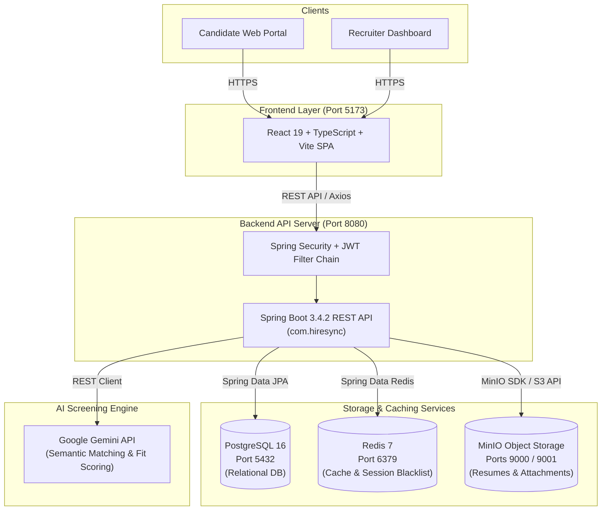

# HireSync

<div align="center">

[](https://github.com/vyshnav-26/HireSync/actions/workflows/ci.yml)
[](https://opensource.org/licenses/MIT)
[](https://www.oracle.com/java/)
[](https://spring.io/projects/spring-boot)
[](https://react.dev/)
[](https://www.typescriptlang.org/)
[](https://www.postgresql.org/)
[](https://redis.io/)

**Next-Gen Applicant Tracking System (ATS) & AI-Powered Recruitment Automation Platform**

### ⚡ Quick Navigation
[About](#about-hiresync) • [Tech Stack](#tech-stack) • [Architecture](#architecture-overview) • [Prerequisites](#prerequisites) • [Quick Start](#quick-start) • [Endpoints](#service-endpoints--verification) • [Environment Variables](#environment-variables) • [CI Pipeline](#continuous-integration-ci) • [Contributing](#contributing) • [License](#license)

</div>

---

## 📑 Table of Contents
- [About HireSync](#about-hiresync)
  - [Key Highlights](#key-highlights)
- [Tech Stack](#tech-stack)
- [Architecture Overview](#architecture-overview)
- [Prerequisites](#prerequisites)
- [Quick Start](#quick-start)
  - [1. Clone Repository](#1-clone-the-repository)
  - [2. Configure Environment Variables](#2-configure-environment-variables)
  - [3. Start Infrastructure via Docker Compose](#3-start-infrastructure-via-docker-compose)
  - [4. Run Services for Local Development](#4-run-services-for-local-development)
- [Service Endpoints & Verification](#service-endpoints--verification)
- [Environment Variables](#environment-variables)
- [Continuous Integration (CI)](#continuous-integration-ci)
- [Contributing](#contributing)
- [License](#license)

---

## About HireSync

**HireSync** is an end-to-end Applicant Tracking System (ATS) and recruitment platform engineered to modernize hiring workflows. From job requisition management and candidate applications to AI-driven resume screening, collaborative evaluation pipelines, and automated candidate communications, HireSync enables recruitment teams to identify and hire top talent efficiently.

### Key Highlights
- **Applicant & Career Portal:** Search and filter public job openings, view detailed requirements, and submit multi-part applications.
- **Recruiter Kanban Pipeline:** Interactive pipeline visualization managing candidates across stages (`Applied` → `Screening` → `Interview` → `Offered` → `Hired` / `Rejected`).
- **AI-Powered Screening (Gemini API):** Automated structured resume parsing, candidate-job description semantic matching, gap analysis, and fit scoring (0–100%).
- **Secure Object Storage:** Dedicated S3-compatible document storage (MinIO) for candidate resumes, portfolios, and job attachments.
- **Enterprise Security & RBAC:** Role-based access control (`ROLE_ADMIN`, `ROLE_RECRUITER`, `ROLE_CANDIDATE`) with stateless JWT auth and Redis token revocation lists.

[↑ Back to Top](#table-of-contents)

---

## Tech Stack

| Layer | Technology | Version | Purpose |
| :--- | :--- | :--- | :--- |
| **Frontend** | React, TypeScript, Vite | 19.x / 8.x | High-performance, responsive single-page application |
| **UI & Styling** | Tailwind CSS, Lucide React | 3.4.x | Utility-first styling framework and icon library |
| **State & Routing** | Zustand, React Router DOM | 5.x / 7.x | Global client state management and declarative routing |
| **Backend API** | Spring Boot, Java | 3.4.2 / 21 | Clean layered REST API, business logic, security |
| **Security** | Spring Security, JJWT | 6.x / 0.12.x | JWT authentication, role-based access control, hashing |
| **Database** | PostgreSQL | 16-Alpine | Relational persistence for users, jobs, applications, and logs |
| **Cache & Sessions** | Redis | 7-Alpine | Session management, token blacklist, high-frequency query caching |
| **Object Storage** | MinIO | S3-Compatible | Object storage for candidate resumes and job attachments |
| **AI Screening** | Google Gemini API | Phase 2 | Structured resume parsing, semantic matching, fit scoring |
| **DevOps & CI/CD** | Docker Compose, GitHub Actions | v2 / v4 | Multi-container local orchestration and automated build checks |

[↑ Back to Top](#table-of-contents)

---

## Architecture Overview



[↑ Back to Top](#table-of-contents)

---

## Prerequisites

Before running the application, make sure you have installed:
- [Docker & Docker Compose](https://www.docker.com/) (v2.20+)
- [Java Development Kit (JDK) 21](https://adoptium.net/) (Eclipse Temurin recommended)
- [Node.js 20+ LTS](https://nodejs.org/) & `npm 10+`
- [Git](https://git-scm.com/)

[↑ Back to Top](#table-of-contents)

---

## Quick Start

### 1. Clone the Repository
```bash
git clone https://github.com/vyshnav-26/HireSync.git
cd HireSync
```

### 2. Configure Environment Variables
Copy `.env.example` to create your local `.env`:
```bash
cp .env.example .env
```
*(Default settings in `.env.example` work out-of-the-box for local Docker development.)*

### 3. Start Infrastructure via Docker Compose
Start the backing infrastructure services (PostgreSQL, Redis, MinIO, and bucket initialization):
```bash
docker compose up -d postgres redis minio minio-init
```

To run the entire stack including the containerized backend:
```bash
docker compose up --build -d
```

To view live service logs:
```bash
docker compose logs -f
```

To stop all containers:
```bash
docker compose down
```

### 4. Run Services for Local Development

#### Backend (Spring Boot API):
```bash
cd backend
mvn spring-boot:run
```
- API Base URL: `http://localhost:8080`
- Health check: `http://localhost:8080/api/v1/health`

#### Frontend (React + Vite):
```bash
cd frontend
npm install
npm run dev
```
- Web Application: `http://localhost:5173`

[↑ Back to Top](#table-of-contents)

---

## Service Endpoints & Verification

| Service | Local URL | Port / Credentials | Description |
| :--- | :--- | :--- | :--- |
| **Frontend UI** | `http://localhost:5173` | Port 5173 | React single-page application |
| **Backend API** | `http://localhost:8080` | Port 8080 | Spring Boot REST API |
| **Health Check** | `http://localhost:8080/api/v1/health` | HTTP GET | API health status probe |
| **MinIO Console** | `http://localhost:9001` | User: `minioadmin`<br>Pass: `minioadmin` | Web storage administration console |
| **MinIO S3 API** | `http://localhost:9000` | Port 9000 | S3-compatible object API |
| **PostgreSQL** | `localhost:5432` | User: `postgres`<br>Pass: `postgres`<br>DB: `hiresync` | Relational database instance |
| **Redis** | `localhost:6379` | Port 6379 | In-memory cache & session store |

[↑ Back to Top](#table-of-contents)

---

## Environment Variables

All core configuration values are defined with defaults in [`.env.example`](.env.example):

| Variable | Default Value | Description |
| :--- | :--- | :--- |
| `SPRING_PROFILES_ACTIVE` | `dev` | Active Spring profile (`dev`, `prod`, `test`) |
| `BACKEND_PORT` | `8080` | Host port for the Spring Boot backend service |
| `POSTGRES_DB` | `hiresync` | PostgreSQL database name |
| `POSTGRES_USER` | `postgres` | PostgreSQL root user |
| `POSTGRES_PASSWORD` | `postgres` | PostgreSQL password |
| `POSTGRES_PORT` | `5432` | PostgreSQL host port mapping |
| `REDIS_PORT` | `6379` | Redis host port mapping |
| `MINIO_ROOT_USER` | `minioadmin` | MinIO root administrator username |
| `MINIO_ROOT_PASSWORD` | `minioadmin` | MinIO root administrator password |
| `MINIO_API_PORT` | `9000` | MinIO S3 API port |
| `MINIO_CONSOLE_PORT` | `9001` | MinIO web management console port |
| `MINIO_BUCKET_NAME` | `hiresync-resumes` | Default bucket for candidate resumes |
| `JWT_SECRET` | *(256-bit hex)* | Secret key for signing JSON Web Tokens |
| `JWT_EXPIRATION_MS` | `86400000` | Access token lifetime (24 hours in milliseconds) |
| `JWT_REFRESH_EXPIRATION_MS` | `604800000` | Refresh token lifetime (7 days in milliseconds) |

[↑ Back to Top](#table-of-contents)

---

## Continuous Integration (CI)

HireSync employs automated CI workflows powered by GitHub Actions ([`.github/workflows/ci.yml`](.github/workflows/ci.yml)):
- **Backend CI:** Runs on JDK 21 (`mvn clean verify`) checking compilation, tests, and packaging.
- **Frontend CI:** Runs on Node 20 (`npm ci && npm run build`) validating TypeScript types and production build integrity.

CI runs automatically on all pull requests and pushes targeting `main`.

[↑ Back to Top](#table-of-contents)

---

## Contributing

We welcome contributions from the community! Please read our **[CONTRIBUTING.md](CONTRIBUTING.md)** for detailed instructions on branching strategy, Conventional Commits, code styling, and pull request procedures.

[↑ Back to Top](#table-of-contents)

---

## License

This project is licensed under the MIT License — see the [LICENSE](LICENSE) file for details.

[↑ Back to Top](#table-of-contents)
